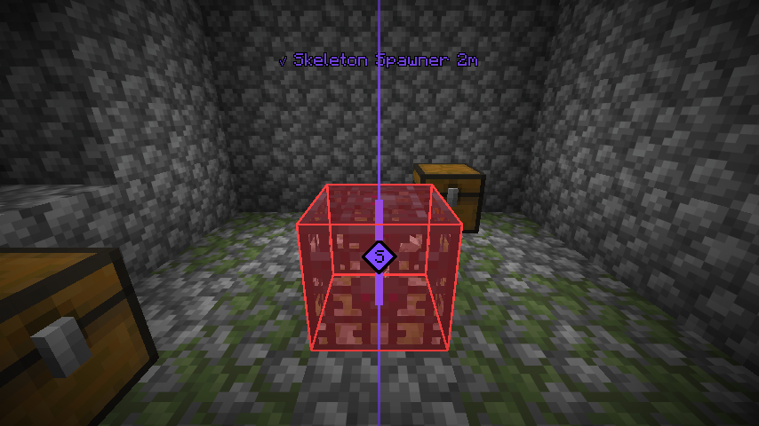
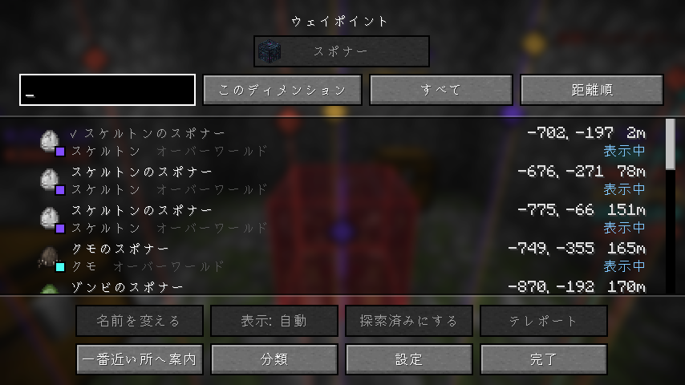
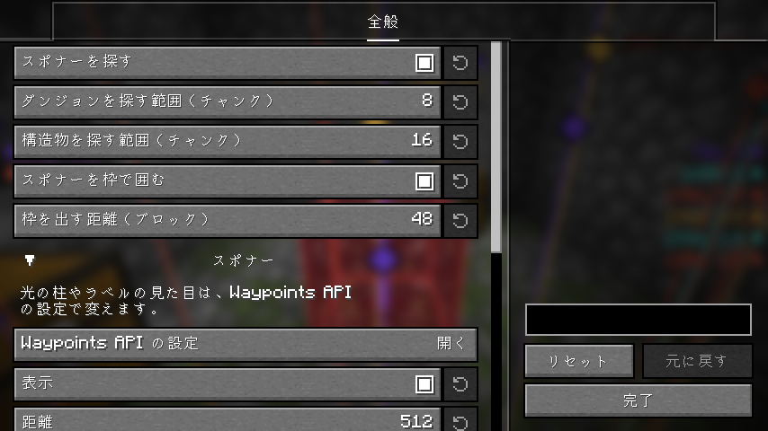

# Spawner Waypoints

[English](README.md) | 日本語

ダンジョンや構造物のスポナーの場所をワールドのシードから計算し、ウェイポイントとして表示する Fabric 向けクライアント MOD です。
クライアントに入れるだけで動作し、バニラサーバーでも使えます（サーバー側への導入は不要です）。

## 機能

### シードから計算するスポナー

まわりのスポナーをワールドのシードから計算するので、着く前に場所が分かります。近いものから順に計算します。

- **ダンジョン**: ゾンビ・スケルトン・クモのスポナー。
- **構造物**: 廃坑の洞窟グモ、要塞のシルバーフィッシュ、ネザー要塞のブレイズ、試練の間の試練のスポナー。
- **別の場所かも**: 廃坑の洞窟グモのスポナーのように、ワールドがチャンクを生成した順番で場所が変わるものは、ありうる場所をすべて出し、名前に「（別の場所かも）」と付けます。
- **今いる場所**: ゲームが読み込んだチャンクでは、実際にあるスポナーを出し、なかったものは消します。

シングルプレイでは、ワールドに入った時点でシードが分かります。サーバーでは `/setseed <シード>` で入力するか、サーバーが許していれば `/seed` を実行してください。

### 枠

近くのスポナーを、壁越しにも見える枠で囲みます。初期設定では 48 ブロック先までです。細い枠は「別の場所かも」のスポナーです。

### ウェイポイント

ウェイポイントは [Waypoints API](https://github.com/LivingDeadDolls/WaypointsAPI) が表示します。この MOD の jar に入っているので、別に入れる必要はありません。ワールドの中の光の柱とラベル、見えていないものを指す画面の端の矢印、すべてを並べた一覧、地図の MOD の印が出ます。

- モブごとに分類が分かれ、スポーンエッグと色が付きます。試練のスポナーは 1 つの分類です。
- 要らないモブを隠す、色を変える、モブごとに一番近いスポナーだけを出す、ができます。
- 一覧から、名前の変更・ピン留め・表示しないの設定ができます。コマンドを使える人はテレポートもできます。

## 設定

設定画面は [Mod Menu](https://modrinth.com/mod/modmenu) から開きます。スポナーを探す範囲、枠、ウェイポイントの見せ方（距離・数・色）を変えられます。

## 必要なもの

- [Fabric API](https://modrinth.com/mod/fabric-api)
- [YetAnotherConfigLib](https://modrinth.com/mod/yacl)
- [Mod Menu](https://modrinth.com/mod/modmenu)（任意。設定画面を開くのに使います）

対応する Minecraft のバージョンは各リリースに記載しています。

## 注意

サーバーによっては、このような MOD の使用をルールで禁止していることがあります。
使用はサーバーのルールに従ってください。
