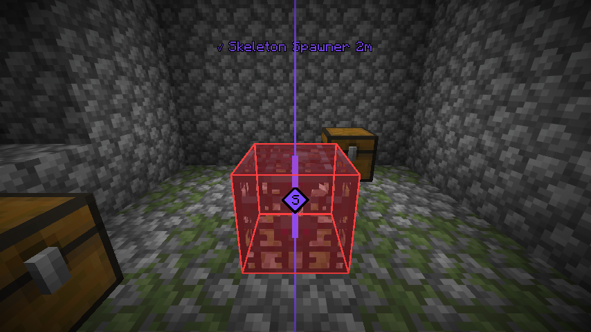
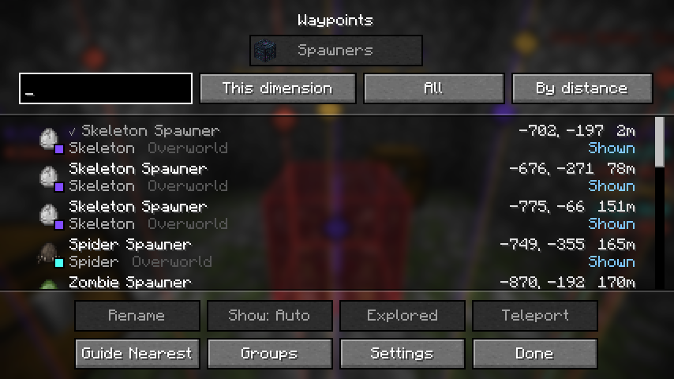
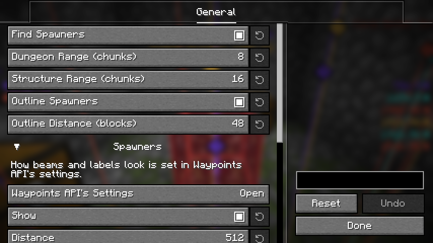

# Spawner Waypoints

English | [日本語](README.ja.md)

A client-side Fabric mod that shows dungeon and structure spawners as waypoints, calculated from the world seed.
Just install it on your client; it also works on vanilla servers (nothing needs to be installed on the server).

## Features

### Spawners from the seed

The spawners around you are worked out from the world's seed, so you can see where they are before you get there. The nearest come first.

- **Dungeons**: zombie, skeleton and spider spawners.
- **Structures**: cave spiders in mineshafts, silverfish in strongholds, blazes in nether fortresses, and the trial spawners of trial chambers.
- **Maybe**: some spawners (a mineshaft's cave spiders) depend on the order in which the world generated its chunks. The places they may be are shown, and their names say "(maybe)".
- **Where you are**: in the chunks the game has loaded, the spawners really there are shown, and the ones that turn out not to exist are dropped.

In singleplayer the seed is known as soon as you join. On a server, enter it with `/setseed <seed>`, or run `/seed` if the server lets you.

### Outlines

The spawners near you are outlined through walls, up to 48 blocks away by default. A thin outline is a "maybe".

### Waypoints

The waypoints are shown by [Waypoints API](https://github.com/LivingDeadDolls/WaypointsAPI), which comes inside this mod's jar: a beam of light and a label in the world, an arrow at the screen's edge for the ones out of sight, one list of all of them, and marks on map mods.

- Each mob has its own group, with its spawn egg and color. Trial spawners are one group of their own.
- Hide the mobs you do not want, change their colors, or show only the nearest spawner of a mob.
- Rename, pin or hide a spawner from the list, or teleport to it when you may run commands.

## Settings

The settings screen is opened from [Mod Menu](https://modrinth.com/mod/modmenu). It has how far spawners are looked for, the outlines, and how the waypoints are shown (distance, count, colors).

## Requirements

- [Fabric API](https://modrinth.com/mod/fabric-api)
- [YetAnotherConfigLib](https://modrinth.com/mod/yacl)
- [Mod Menu](https://modrinth.com/mod/modmenu) (optional, for opening the settings screen)

The supported Minecraft versions are listed on each release.

## Note

Some servers do not allow mods like this one by their rules.
Follow the rules of the server you play on.
